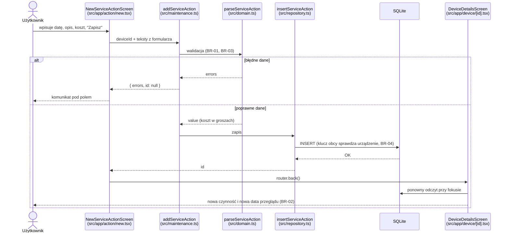
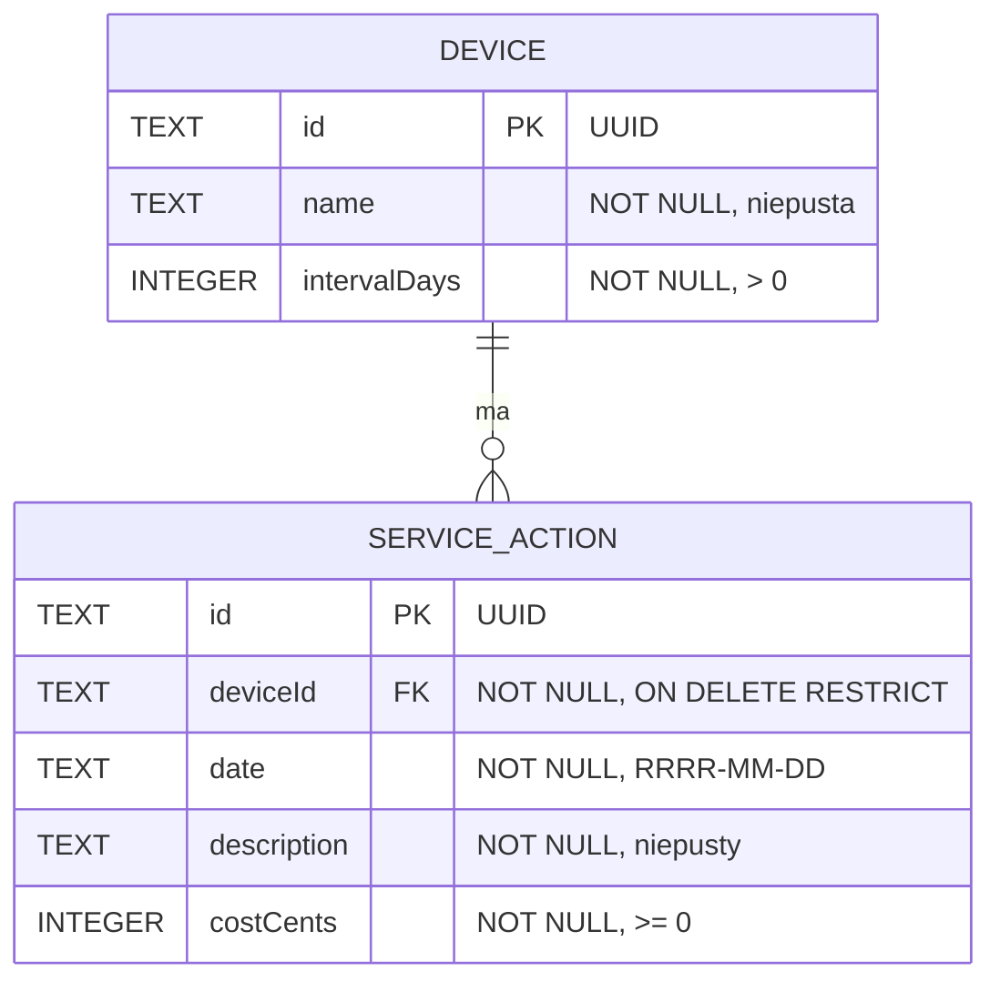

# Laboratorium 2 — sprawozdanie teoretyczne

**Imię i nazwisko:** Artur Rok  
**Grupa:** 43_Inf_FD_NW_7  
**Data:** 2026-11-07

## Zasady opracowania

1. Odpowiedz samodzielnie, korzystając z materiałów udostępnionych na Moodle oraz dodatkowych źródeł technicznych (np. oficjalnej dokumentacji).
2. Nie ograniczaj odpowiedzi do definicji. Wyjaśniaj własnymi słowami, uzasadniaj wnioski i podawaj przykłady.
3. W zadaniach odnoszących się do projektu użyj **własnego, przydzielonego tematu aplikacji**.
4. Podaj źródła wykorzystane do opracowania odpowiedzi. Sam link bez wskazania, do czego został wykorzystany, nie wystarcza.

Mój temat: **MOB-050 MaintenanceLog**, aplikacja do planowania okresowych przeglądów sprzętu. Encja nadrzędna: urządzenie (nazwa, interwał przeglądów w dniach). Encja podrzędna: czynność serwisowa (data, opis, koszt). Numery źródeł w nawiasach kwadratowych odnoszą się do bibliografii na końcu.

## T1. Podejścia do tworzenia aplikacji mobilnych

**Polecenie:** Zbadaj cztery podejścia: natywne, wieloplatformowe, hybrydowe (WebView) i PWA.

**A.** Uzupełnij tabelę. Zwróć uwagę, że „wieloplatformowe” i „hybrydowe” nie muszą oznaczać tego samego.

| Kryterium                    | Natywne | Wieloplatformowe | Hybrydowe (WebView) | PWA |
| ---------------------------- | ------- | ---------------- | ------------------- | --- |
| Sposób tworzenia interfejsu  | Osobny kod dla każdego systemu w jego narzędziach (Swift + SwiftUI/UIKit, Kotlin + Jetpack Compose). Kontrolki są systemowe. | Jeden kod we wspólnym języku. React Native i NativeScript zamieniają komponenty na prawdziwe widoki systemowe, Flutter rysuje cały interfejs własnym silnikiem graficznym. | HTML, CSS i JavaScript wyświetlane w komponencie WebView wewnątrz natywnej „powłoki” aplikacji (Cordova, Capacitor). | Zwykła strona internetowa (HTML, CSS, JS) z manifestem i Service Workerem, uruchamiana przez przeglądarkę. |
| Dostęp do funkcji urządzenia | Pełny i od razu po wydaniu nowej wersji systemu. | Przez moduły natywne frameworka (np. `expo-camera`, `expo-sqlite`). Brakujący moduł można napisać samemu w Swift/Kotlin. | Przez wtyczki, które łączą JavaScript z natywnym API. Zakres zależy od dostępnych wtyczek. | Tylko przez Web API udostępnione przez przeglądarkę (np. `getUserMedia` dla aparatu). Na iOS część API jest niedostępna lub ograniczona. |
| Dystrybucja aplikacji        | App Store, Google Play (lub plik APK). | App Store, Google Play; w Expo dodatkowo aktualizacje kodu JS bez sklepu (EAS Update). | App Store, Google Play. | Adres URL; instalacja z przeglądarki na ekran główny, bez sklepu i jego recenzji. |
| Typowe ograniczenie          | Dwie bazy kodu i dwa zespoły kompetencji, wyższy koszt. | Warstwa pośrednia: aktualizacje frameworka, zależność od modułów zewnętrznych, czasem trzeba zejść do kodu natywnego. | WebView jest wolniejszy przy złożonych listach i animacjach; UI nie zachowuje się jak natywny (przewijanie, klawiatura). | Brak gwarancji trwałości danych (przeglądarka może je usunąć), ograniczone API, szczególnie na iOS. |
| Przykładowa technologia      | Swift/SwiftUI, Kotlin/Jetpack Compose | React Native (Expo), Flutter, NativeScript | Ionic + Capacitor, Apache Cordova | Strona z Web App Manifest i Service Workerem (np. aplikacja Vite + Workbox) |

Różnica między „wieloplatformowym” a „hybrydowym”: oba podejścia mają jeden kod dla wielu systemów, ale aplikacja hybrydowa nadal jest stroną internetową w WebView, a aplikacja wieloplatformowa wyświetla natywne widoki (React Native) lub rysuje je własnym silnikiem (Flutter) bez przeglądarki [1], [2], [4].

**B.** Wybierz dwa podejścia do aplikacji wymagającej działania bez internetu i dostępu do aparatu. Porównaj je, wskazując założenia i ryzyka.

**Odpowiedź:**

Porównuję **wieloplatformowe (React Native z Expo)** i **PWA**, bo oba używają tych samych umiejętności (TypeScript, React), a różnią się miejscem uruchomienia.

*Założenia przykładu:* technik serwisu robi zdjęcie tabliczki znamionowej urządzenia w piwnicy bez zasięgu, zapisuje czynność serwisową i chce ją zobaczyć za tydzień.

| Aspekt | React Native (Expo) | PWA |
| ------ | ------------------- | --- |
| Działanie bez internetu | Kod aplikacji jest w zainstalowanym pakiecie, więc start nie wymaga sieci. Dane w SQLite w katalogu aplikacji. | Działa offline tylko wtedy, gdy Service Worker wcześniej zapisał pliki w cache. Pierwsze uruchomienie zawsze wymaga sieci. |
| Trwałość danych | Plik bazy jest usuwany dopiero przy odinstalowaniu aplikacji. | IndexedDB jest w „best-effort” storage: przeglądarka może usunąć dane przy braku miejsca, a Safari z włączoną ochroną przed śledzeniem usuwa dane zapisane skryptem, gdy użytkownik nie wszedł w interakcję z witryną przez 7 dni używania przeglądarki [6]. |
| Aparat | Moduł `expo-camera` lub `expo-image-picker`, systemowe okno zgody. | `getUserMedia` lub `<input type="file" capture>` [7]. Działa, ale bez kontroli nad np. lampą błyskową na wszystkich przeglądarkach. |
| Dystrybucja | Sklep lub development build, potrzebne konto deweloperskie. | Link, bez instalacji ze sklepu. |

*Ryzyka React Native:* aktualizacja SDK Expo co kilka miesięcy zmienia API (w tym projekcie np. ESLint 10 nie działał z konfiguracją Expo), a funkcja bez gotowego modułu wymaga kodu natywnego. *Ryzyka PWA:* utrata zapisanych rekordów bez ostrzeżenia oraz różnice między przeglądarkami (iOS ma tylko silnik WebKit).

*Wniosek:* dla aplikacji, która musi działać offline i przechowywać dane miesiącami, ryzyko utraty danych w PWA jest ważniejsze niż łatwiejsza dystrybucja. Wybieram podejście wieloplatformowe. Dodatkowo w moim projekcie wymaganie TECH-01 wprost wyklucza PWA.

**C.** Wskaż źródła, na podstawie których dokonałeś porównania.

**Źródła:**

- [1] React Native, „Core Components and Native Components” — jak komponenty React stają się widokami natywnymi (wiersz „Sposób tworzenia interfejsu”).
- [2] Flutter, „Flutter architectural overview” — że Flutter rysuje widgety własnym silnikiem, a nie kontrolkami systemu.
- [4] Capacitor, dokumentacja — model aplikacji hybrydowej: aplikacja webowa w natywnym kontenerze i wtyczki do API urządzenia.
- [5] MDN, „Progressive web apps” — manifest, Service Worker, instalacja z przeglądarki i działanie offline.
- [6] MDN, „Storage quotas and eviction criteria” — kiedy przeglądarka usuwa dane PWA (ryzyko w punkcie B).
- [7] MDN, „MediaDevices.getUserMedia()” — dostęp do aparatu w PWA.
- [8] Expo, „SQLite (expo-sqlite)”, SDK 57 — lokalna baza w React Native.
- [13] Materiały Moodle do tematu 2 — definicje czterech podejść i kryteria wyboru technologii.

## T2. Architektura i podział odpowiedzialności

**Polecenie:** Wyjaśnij, dlaczego oddzielenie interfejsu, logiki aplikacji i dostępu do danych jest przydatne w projekcie CRUD.

**A.** Opisz własnymi słowami odpowiedzialność trzech wymienionych obszarów. Podaj po jednym przykładzie operacji, która powinna należeć do każdego z nich.

**Odpowiedź:**

- **Interfejs (UI):** pokazuje dane i zbiera dane od użytkownika. Wie, jak coś wygląda, ale nie wie, czy dane są poprawne ani gdzie są zapisane. *Przykład z MaintenanceLog:* ekran „Nowa czynność” trzyma wpisany tekst kosztu `"49,99"` i po otrzymaniu błędu pokazuje komunikat w wierszu pod polem.
- **Logika aplikacji (domena):** zawiera reguły biznesowe i obliczenia. Nie zależy od React Native ani od bazy, więc można ją uruchomić w zwykłym teście. *Przykład:* obliczenie „następny przegląd = ostatni przegląd + interwał” (MOB-050-BR-02) w funkcji `nextReviewDate("2026-11-07", 90)`, która zwraca `"2027-02-05"`.
- **Dostęp do danych (repozytorium):** jedyne miejsce, które zna SQL i strukturę tabel. Zapisuje i odczytuje rekordy. *Przykład:* `insertServiceAction` wykonuje `INSERT INTO service_actions ...`, a `listDevices` pobiera urządzenia razem z datą ostatniej czynności (`MAX(date)`).

Taki podział jest przydatny w CRUD, bo te same reguły są potrzebne w kilku miejscach (formularz dodawania i, od laboratorium 3, formularz edycji). Gdy reguła jest w jednej funkcji, zmiana interwału z „> 0” na „>= 7 dni” zmienia się raz. Podobne zalecenie (warstwa UI oddzielona od warstwy danych, opcjonalna warstwa domeny) podaje przewodnik architektury Androida [3], a materiały z Moodle przedstawiają ten sam podział na warstwy [13].

**B.** Rozważ sytuację: ekran formularza bezpośrednio zapisuje dane do bazy, sprawdza reguły biznesowe i wyświetla komunikaty. Zidentyfikuj **dwa konkretne problemy** takiego rozwiązania i zaproponuj zmianę.

**Odpowiedź:**

1. **Powielone reguły, które się rozjeżdżają.** W MaintenanceLog walidacja kosztu jest potrzebna przy dodawaniu i przy edycji czynności. Jeżeli każdy ekran ma własny `if`, to po zmianie reguły (np. dopuszczenie kosztu z przecinkiem) jeden ekran zostanie poprawiony, a drugi nie. Użytkownik może wtedy zapisać koszt w edycji, którego nie da się zapisać w dodawaniu.
2. **Brak możliwości szybkiego testu.** Aby sprawdzić, czy `90` dni po `2026-11-07` daje `2027-02-05`, trzeba by uruchomić symulator, wypełnić formularz i odczytać ekran. Test regułu przejścia przez koniec roku zajmuje wtedy minuty zamiast milisekund, więc w praktyce nikt go nie powtarza. Dodatkowo zmiana bazy (np. z AsyncStorage na SQLite) wymaga przepisania każdego ekranu, bo zapytania są rozrzucone po komponentach.

**Proponowana zmiana (zastosowana w projekcie):** formularz przekazuje surowe teksty do funkcji `addServiceAction` (`src/maintenance.ts`). Ta wywołuje walidację z `src/domain.ts`, a dopiero dla poprawnych danych repozytorium `src/repository.ts`. Ekran dostaje z powrotem obiekt `{ errors, id }` i tylko go wyświetla. Reguły mają 10 testów jednostkowych uruchamianych przez `bun test` w kilka milisekund.

**C.** Naszkicuj przepływ danych podczas dodawania rekordu w Twojej aplikacji (diagram Mermaid albo opis kolejnych kroków). Nazwij odpowiedzialne komponenty.

**Diagram / opis:**

## T3. Model danych i reguły biznesowe

**Polecenie:** Zaprojektuj model danych na podstawie **własnych wymagań biznesowych**.

**A.** Wskaż co najmniej dwie encje, ich atrybuty (z typami danych) oraz relację. Zaznacz identyfikatory i pola wymagane.

| Encja | Atrybut | Typ | Wymagane? | Uzasadnienie |
| ----- | ------- | --- | --------- | ------------ |
| Device | `id` (PK) | TEXT, UUID | Tak | Identyfikator. UUID generowany na urządzeniu, więc nie zależy od kolejności zapisu i nie zdradza liczby rekordów. |
| Device | `name` | TEXT | Tak | Nazwa, po której użytkownik rozpoznaje sprzęt. Pusta nazwa jest zabroniona (BR-03). |
| Device | `intervalDays` | INTEGER | Tak | Co ile dni wykonać przegląd. Liczba całkowita `> 0` (BR-01), bo przegląd co 0 lub co 1,5 dnia nie ma sensu. |
| ServiceAction | `id` (PK) | TEXT, UUID | Tak | Identyfikator czynności. |
| ServiceAction | `deviceId` (FK) | TEXT, UUID | Tak | Urządzenie, którego dotyczy czynność. Bez niego czynność nie ma sensu (BR-04). |
| ServiceAction | `date` | TEXT, `RRRR-MM-DD` | Tak | Data wykonania. Tekst bez godziny i strefy czasowej, bo przegląd dotyczy dnia, a nie chwili; uniknięcie przesunięcia o jeden dzień przy strefie UTC+1/+2. |
| ServiceAction | `description` | TEXT | Tak | Co zrobiono, np. „Wymiana szczotek”. |
| ServiceAction | `costCents` | INTEGER | Tak | Koszt w groszach. Karta wymaga wartości dziesiętnych bez błędów `float`, a SQLite nie ma typu `DECIMAL`. 49,99 zł zapisuje się jako `4999`. Koszt może być `0` (przegląd gwarancyjny), ale nie ujemny (BR-01). |

Relacja: jedno urządzenie ma zero lub wiele czynności serwisowych (1:N). Każda czynność należy do dokładnie jednego urządzenia. Data ostatniego przeglądu nie jest osobnym polem, tylko wynikiem `MAX(date)` z czynności urządzenia, więc nie może się rozjechać z historią.

**B.** Przedstaw diagram relacji encji (np. Mermaid `erDiagram`) albo własny czytelny schemat.

**Diagram:**

**C.** Opisz **dwie reguły biznesowe** specyficzne dla Twojego projektu. Dla każdej podaj przypadek poprawny i niepoprawny.

**Odpowiedź:**

**Reguła 1, MOB-050-BR-02: następny przegląd = ostatni przegląd + interwał.** Ostatni przegląd to najpóźniejsza data czynności danego urządzenia.

- *Poprawny przypadek:* wiertarka z interwałem 90 dni, czynności 2026-08-01 i 2026-11-07. Ostatni przegląd to 2026-11-07, następny 2027-02-05 (przejście przez koniec roku). Kolejność dodawania nie ma znaczenia: dopisanie później starszej czynności z 2026-05-01 nie zmienia wyniku.
- *Niepoprawny przypadek:* urządzenie bez żadnej czynności. Nie ma daty bazowej, więc daty następnego przeglądu nie da się obliczyć. Aplikacja nie wymyśla daty (np. od dnia dodania urządzenia), tylko pokazuje „brak przeglądów”. Niepoprawne byłoby też liczenie od ostatnio *dodanej*, a nie najpóźniejszej czynności.

**Reguła 2, MOB-050-BR-04: nie można zapisać rekordu podrzędnego bez istniejącego urządzenia ani usunąć urządzenia, które ma czynności.**

- *Poprawny przypadek:* użytkownik otwiera szczegóły „Wiertarka Bosch” i dodaje czynność. `deviceId` pochodzi z nawigacji, urządzenie istnieje, zapis się udaje. Usunięcie urządzenia bez czynności (np. wpisanego przez pomyłkę) jest dozwolone.
- *Niepoprawny przypadek:* próba usunięcia wiertarki, która ma 2 czynności. Usunięcie zostaje zablokowane (`ON DELETE RESTRICT` w bazie), a użytkownik widzi komunikat, że urządzenie ma powiązane czynności. Gdyby usunięcie przeszło, czynności zostałyby „osierocone” albo historia kosztów zniknęłaby bez ostrzeżenia. Drugi niepoprawny przypadek: zapis czynności z `deviceId` urządzenia usuniętego na innym ekranie; baza odrzuca `INSERT`, a formularz pokazuje błąd zapisu.

SQLite domyślnie nie sprawdza kluczy obcych; trzeba włączyć `PRAGMA foreign_keys = ON` przy każdym połączeniu [9]. W projekcie robi to `src/repository.ts`.

## T4. Nawigacja i zarządzanie stanem

**Polecenie:** Zaplanuj sposób przechodzenia między ekranami oraz przepływ informacji w aplikacji.

**A.** Zidentyfikuj co najmniej trzy ekrany własnej aplikacji. Dla każdego określ jego cel, dane wejściowe i możliwe akcje użytkownika.

| Ekran | Cel | Dane wejściowe | Akcje użytkownika |
| ----- | --- | -------------- | ----------------- |
| Lista urządzeń (`/`) | Pokazać wszystkie urządzenia i datę ich następnego przeglądu, żeby od razu widać było, co wymaga uwagi. | Brak parametrów; urządzenia z bazy z datą ostatniej czynności. | Otwarcie szczegółów urządzenia; dodanie urządzenia. W laboratorium 3: wyszukiwanie po nazwie, sortowanie. |
| Szczegóły urządzenia (`/device/[id]`) | Pokazać interwał, następny przegląd i historię czynności jednego urządzenia. | `id` urządzenia z trasy; urządzenie i jego czynności z bazy. | Dodanie czynności (przekazuje `deviceId`); otwarcie szczegółów czynności; powrót. W laboratorium 3: edycja, usunięcie. |
| Formularz czynności (`/action/new?deviceId=...`) | Zapisać nową czynność serwisową dla wybranego urządzenia. | `deviceId` z parametru; data (domyślnie dzisiejsza), opis, koszt wpisywane przez użytkownika. | Zapis; poprawa błędnych pól; powrót bez zapisu. |
| Formularz urządzenia (`/device/new`) | Dodać urządzenie. | Nazwa, interwał w dniach. | Zapis; powrót. |
| Szczegóły czynności (`/action/[id]`) | Pokazać pełne dane jednej czynności. | `id` czynności z trasy. | Powrót. W laboratorium 3: edycja, usunięcie z potwierdzeniem. |

**B.** Wyjaśnij różnicę między stanem lokalnym formularza a danymi utrwalonymi. Opisz, co powinno się wydarzyć po zapisaniu nowego rekordu i powrocie do listy.

**Odpowiedź:**

**Stan lokalny formularza** to to, co użytkownik właśnie wpisuje: teksty pól, błędy walidacji, flaga „trwa zapis”. Żyje w `useState` ekranu, może być niepoprawny (np. koszt `"-5"` albo niedokończona data `"2026-11-"`) i znika po zamknięciu ekranu. Dlatego koszt jest w nim tekstem, a nie liczbą: użytkownik w trakcie pisania może mieć `"49,"`.

**Dane utrwalone** to rekordy w SQLite. Są zawsze poprawne (przeszły walidację i ograniczenia bazy), mają typy docelowe (`costCents = 4999`) i przetrwają zamknięcie aplikacji. Formularz zamienia się w rekord dopiero w chwili udanego zapisu.

**Po zapisie i powrocie** powinno się wydarzyć kolejno:

1. Zapis kończy się sukcesem, dopiero wtedy formularz się zamyka (przy błędzie zostaje otwarty z wpisanymi danymi).
2. Stan formularza jest odrzucany razem z ekranem, więc następne otwarcie formularza jest puste.
3. Ekran, na który wracamy, pokazuje nowy rekord bez ręcznego odświeżania. W MaintenanceLog szczegóły urządzenia odczytują dane z bazy przy każdym uzyskaniu fokusu (`useFocusEffect` [10]), więc widzą nową czynność i nową datę następnego przeglądu. Lista urządzeń robi to samo po powrocie.
4. Karta wymaga też potwierdzenia sukcesu (FR-09); obecnie jest nim powrót z widocznym nowym rekordem, krótki komunikat dodam w laboratorium 3.

**C.** Wskaż jeden problem wynikający z niespójności stanu między ekranami i zaproponuj sposób jego uniknięcia.

**Odpowiedź:**

**Problem:** nieaktualna data następnego przeglądu na liście. Lista urządzeń pobiera dane raz przy pierwszym wyświetleniu i trzyma je w swoim stanie. Użytkownik wchodzi w wiertarkę, dodaje przegląd z dzisiejszą datą i wraca. Stos nawigacji nie odmontował listy, więc ta nadal pokazuje stary termin (np. „przegląd zaległy od miesiąca”), chociaż w bazie jest już nowy. Użytkownik może uznać, że zapis się nie udał, i dodać czynność drugi raz, co tworzy duplikat i zawyża koszty.

**Rozwiązanie zastosowane w projekcie:** jedno źródło prawdy, czyli baza. Ekrany nie trzymają własnej kopii danych dłużej niż do utraty fokusu: hook `useFocusData` ponownie czyta dane z repozytorium przy każdym powrocie na ekran. Koszt to jedno zapytanie SQLite na powrót, przy kilkuset rekordach pomijalne. **Alternatywa** przy większej aplikacji: wspólny cache zapytań (np. React Query), który po zapisie unieważnia klucze `devices` i `device/[id]`. Nie wybrałem jej, bo dodaje zależność i drugi stan do synchronizacji, a nie rozwiązuje problemu, którego tu nie ma.

## T5. Trwałość danych, walidacja i błędy

**Polecenie:** Zbadaj konsekwencje wyboru mechanizmu przechowywania danych i zaplanuj obsługę sytuacji niepoprawnych.

**A.** Porównaj przechowywanie danych wyłącznie w pamięci aplikacji z lokalną trwałą bazą danych. Kiedy dane zostaną utracone? Które podejście spełnia wymagania Twojego projektu?

**Odpowiedź:**

| | Tylko pamięć (np. `useState`, globalny store bez zapisu) | Lokalna baza (SQLite) |
| - | --- | --- |
| Gdzie są dane | W pamięci RAM procesu aplikacji. | W pliku bazy w katalogu danych aplikacji na dysku. |
| Kiedy giną | Przy zamknięciu aplikacji przez użytkownika, przy restarcie telefonu, gdy system zabije aplikację w tle z braku pamięci (na iOS i Androidzie dzieje się to bez ostrzeżenia), przy przeładowaniu kodu w trakcie developmentu, przy awarii aplikacji. Stan ekranu ginie też po jego zamknięciu. | Przy odinstalowaniu aplikacji lub wyczyszczeniu danych aplikacji w ustawieniach systemu, przy uszkodzeniu lub utracie telefonu (brak kopii zapasowej w obecnym zakresie projektu). |
| Zalety | Brak kodu zapisu, natychmiastowy dostęp. | Dane przetrwają restart; zapytania (`MAX`, `ORDER BY`, wyszukiwanie) i ograniczenia spójności (`CHECK`, klucze obce) wykonuje baza. |
| Wady | Nie spełnia podstawowego celu aplikacji. | Operacje asynchroniczne, trzeba obsłużyć błąd zapisu i zaplanować migracje schematu przy zmianach modelu. |

MaintenanceLog planuje przeglądy co 90 czy 365 dni. Dane muszą przetrwać miesiące i wiele restartów telefonu, a wymagania MOB-050-FR-11 i TECH-04 wprost wymagają zachowania danych po ponownym uruchomieniu. Spełnia je tylko lokalna baza. Wybrałem SQLite (`expo-sqlite` [8]) zamiast magazynu klucz-wartość, bo model ma relację 1:N i regułę BR-04, którą baza może wymusić sama. Pamięć używana jest tylko dla stanu formularza, który z założenia jest tymczasowy. Działanie sprawdziłem testem TC-04 w sprawozdaniu praktycznym: rekord pozostał po zamknięciu i ponownym uruchomieniu aplikacji.

**B.** Wskaż trzy przypadki walidacji wynikające z wymagań Twojej aplikacji. Dla każdego określ warunek oraz komunikat dla użytkownika.

| Pole / operacja | Warunek poprawności | Przykład błędnych danych | Komunikat |
| --------------- | ------------------- | ------------------------ | --------- |
| Urządzenie: interwał (BR-01, BR-03) | Liczba całkowita `> 0` (dni). | `0`, `-30`, `1,5`, puste pole | „Interwał musi być liczbą całkowitą większą od 0.” |
| Czynność: koszt (BR-01) | Liczba `>= 0`, najwyżej 2 miejsca po przecinku; akceptowany przecinek i kropka. | `-5`, `12,345`, `abc` | „Koszt musi być liczbą większą lub równą 0, maks. 2 miejsca po przecinku.” |
| Czynność: data (BR-03) | Format `RRRR-MM-DD` i istniejący dzień kalendarza. | `2026-02-30`, `2026-13-01`, `07.11.2026` | „Podaj poprawną datę w formacie RRRR-MM-DD.” |
| Urządzenie: nazwa (BR-03) | Niepusta po usunięciu spacji z początku i końca. | `""`, `"   "` | „Nazwa urządzenia jest wymagana.” |

Komunikat jest wyświetlany w tej samej sekcji formularza, bezpośrednio pod polem, którego dotyczy. Komunikat mówi, jaka wartość jest poprawna, a nie tylko „błąd”, żeby użytkownik wiedział, co poprawić. Wszystkie błędy formularza pokazuję naraz, a nie pierwszy z nich, żeby nie trzeba było zapisywać kilka razy.

**C.** Opisz zachowanie aplikacji w dwóch sytuacjach: (1) lista nie zawiera rekordów; (2) zapis danych kończy się błędem. Wyjaśnij, co użytkownik powinien zobaczyć i dlaczego.

**Odpowiedź:**

**(1) Pusta lista.** Przy pierwszym uruchomieniu lista urządzeń pokazuje tekst „Brak urządzeń. Dodaj pierwsze urządzenie, aby planować przeglądy.” i widoczny przycisk „Dodaj urządzenie”. Szczegóły urządzenia bez czynności pokazują „Brak czynności dla tego urządzenia.”, a w miejscu daty następnego przeglądu tekst „dodaj pierwszą czynność”. Dlaczego: pusty biały ekran wygląda jak błąd ładowania albo zawieszenie. Tekst odróżnia stan „nie ma danych” od „dane się nie wczytały” i mówi, jaki jest następny krok. Stan ładowania (systemowy wskaźnik aktywności) jest osobny, żeby przez ułamek sekundy przy starcie nie migał komunikat o pustej liście.

**(2) Błąd zapisu.** Mogą być dwa rodzaje błędu:

- *Błąd walidacji* (np. koszt `-5`): baza nie jest używana, formularz zostaje otwarty, wpisane dane zostają, pod błędnym polem jest komunikat z tabeli w punkcie B.
- *Błąd bazy* (np. brak miejsca na dysku albo urządzenie usunięte w międzyczasie, więc klucz obcy odrzuca `INSERT`): aplikacja pokazuje okno „Błąd zapisu” z krótkim opisem, np. „Nie udało się zapisać czynności. Sprawdź, czy urządzenie nadal istnieje.” Formularz zostaje otwarty z danymi, a przycisk „Zapisz” wraca do stanu aktywnego.

Dlaczego: najgorsze, co może się stać, to cicha utrata danych, czyli zamknięcie formularza, jakby zapis się udał. Użytkownik wierzyłby, że przegląd jest zapisany, a za 90 dni aplikacja nie przypomniałaby o kolejnym. Dlatego formularz zamyka się tylko po potwierdzonym zapisie, a w czasie zapisu przycisk jest zablokowany („Zapisywanie...”), żeby podwójne tapnięcie nie utworzyło dwóch rekordów.

## Wnioski końcowe

1. Która decyzja architektoniczna w Twoim projekcie jest obecnie najważniejsza i dlaczego?
2. Jaką kwestię musisz jeszcze zweryfikować przed dalszą implementacją?

**Wnioski:**

1. Najważniejsza decyzja to **lokalna baza SQLite jako jedyne źródło prawdy**, z regułami spójności zapisanymi także w schemacie (klucz obcy z `ON DELETE RESTRICT`, `CHECK` dla interwału i kosztu). Od niej zależą pozostałe wybory: ekrany nie potrzebują globalnego magazynu stanu, bo czytają z bazy przy fokusie, reguła BR-04 jest wymuszana nawet przy błędzie w kodzie interfejsu, a data następnego przeglądu jest liczona z historii (`MAX(date)`), więc nie może być niezgodna z czynnościami. Zmiana tej decyzji później wymagałaby migracji danych zapisanych już przez użytkowników.
2. Przed dalszą implementacją muszę zweryfikować **migracje schematu bazy**. Obecnie tabele tworzy `CREATE TABLE IF NOT EXISTS`, co nie zmieni istniejącej tabeli, gdy w laboratorium 3 dodam np. kolumnę do wyszukiwania lub filtrowania. Planuję numer wersji schematu w `PRAGMA user_version` i migracje wykonywane przy otwarciu bazy [9], [11]. Druga kwestia to sprawdzenie aplikacji na Androidzie, bo do tej pory testowałem ją na symulatorze iOS.

## Bibliografia / wykorzystane źródła

Dla każdego źródła podaj tytuł, adres lub identyfikator, datę dostępu (dla źródeł internetowych) oraz zadanie, w którym je wykorzystano.

1. React Native, „Core Components and Native Components”, https://reactnative.dev/docs/intro-react-native-components, dostęp 2026-11-07. Wykorzystane w T1.A: w czasie działania React Native tworzy dla komponentów odpowiadające widoki Androida i iOS (np. `<TextInput>` to `EditText` i `UITextField`), więc nie używa WebView.
2. Flutter, „Flutter architectural overview”, https://docs.flutter.dev/resources/architectural-overview, dostęp 2026-11-07. Wykorzystane w T1.A: Flutter rysuje interfejs własnym silnikiem zamiast kontrolek systemowych.
3. Android Developers, „Guide to app architecture”, https://developer.android.com/topic/architecture, dostęp 2026-11-07. Wykorzystane w T2.A: podział na warstwę UI, domeny i danych, jedno źródło prawdy dla danych (także T4.C).
4. Ionic, „Capacitor Documentation”, https://capacitorjs.com/docs, dostęp 2026-11-07. Wykorzystane w T1.A: model aplikacji hybrydowej (aplikacja webowa w natywnym kontenerze, wtyczki do API urządzenia).
5. MDN Web Docs, „Progressive web apps”, https://developer.mozilla.org/en-US/docs/Web/Progressive_web_apps, dostęp 2026-11-07. Wykorzystane w T1.A i T1.B: manifest, Service Worker, instalacja i praca offline PWA.
6. MDN Web Docs, „Storage quotas and eviction criteria”, https://developer.mozilla.org/en-US/docs/Web/API/Storage_API/Storage_quotas_and_eviction_criteria, dostęp 2026-11-07. Wykorzystane w T1.B: dane PWA są domyślnie „best-effort”, a Safari z ochroną przed śledzeniem usuwa je po 7 dniach bez interakcji.
7. MDN Web Docs, „MediaDevices: getUserMedia() method”, https://developer.mozilla.org/en-US/docs/Web/API/MediaDevices/getUserMedia, dostęp 2026-11-07. Wykorzystane w T1.A i T1.B: dostęp PWA do aparatu.
8. Expo, „SQLite (expo-sqlite)”, SDK 57, https://docs.expo.dev/versions/v57.0.0/sdk/sqlite/, dostęp 2026-11-07. Wykorzystane w T1.B i T5.A: lokalna baza w Expo, API zapisu i odczytu użyte w `src/repository.ts`.
9. SQLite, „SQLite Foreign Key Support”, https://www.sqlite.org/foreignkeys.html, dostęp 2026-11-07. Wykorzystane w T3.C: `PRAGMA foreign_keys = ON` jest wymagane, działanie `ON DELETE RESTRICT`.
10. React Navigation, „useFocusEffect”, https://reactnavigation.org/docs/use-focus-effect/, dostęp 2026-11-07. Wykorzystane w T4.B i T4.C: odświeżenie danych przy powrocie na ekran ze stosu (Expo Router udostępnia ten hook).
11. SQLite, „PRAGMA statements: user_version”, https://www.sqlite.org/pragma.html#pragma_user_version, dostęp 2026-11-07. Wykorzystane we wnioskach: numer wersji schematu do migracji.
12. Expo Router, „Introduction to Expo Router”, https://docs.expo.dev/router/introduction/, dostęp 2026-11-07. Wykorzystane w T4.A: trasy z plików w `src/app/` i parametry tras (`[id]`, `deviceId`).
13. Moodle WSB Merito, „Budowa aplikacji mobilnych z użyciem technologii frontendowych”, materiały do laboratorium 2 (Temat 2, „Źródła wiedzy”), dostęp 2026-11-07. Wykorzystane w T1 i T2: podział na cztery podejścia, kryteria wyboru technologii, warstwy aplikacji i projektowanie danych.
14. Karta projektu `business-requirements_50.md` (MOB-050) i `requirements.md` w repozytorium. Wykorzystane w T1.B, T3, T4 i T5: wymagania FR, BR, TECH, z których wynikają encje, reguły i walidacja.

Ocena uwzględnia poprawność merytoryczną, kompletność, uzasadnienie decyzji, odniesienie do własnego projektu oraz jakość dokumentacji. Samo przepisanie definicji bez analizy nie jest wystarczające.
