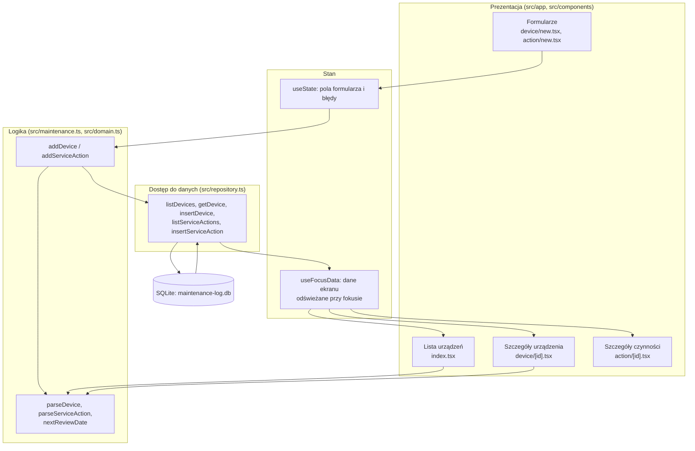
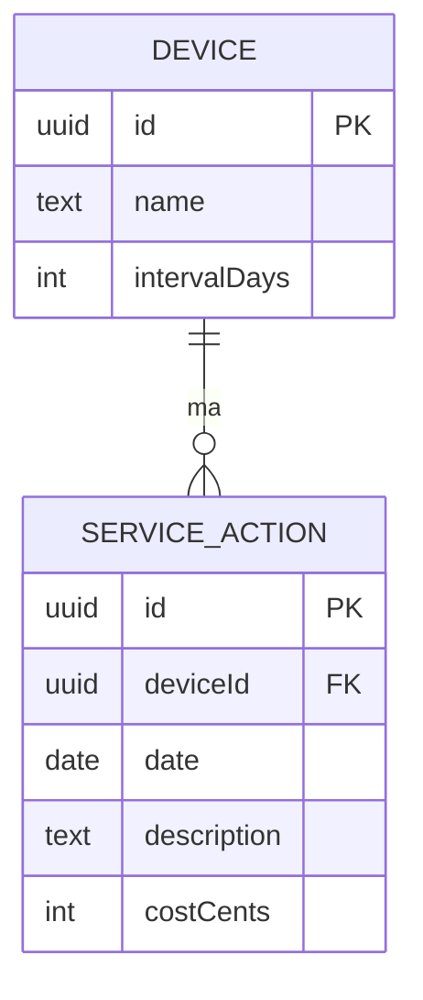

# Architektura MaintenanceLog (MOB-050)

## Struktura projektu

```text
src/
├── app/                      # warstwa prezentacji: ekrany Expo Router (każdy plik = ekran)
│   ├── _layout.tsx           # nawigator Stack i tytuły ekranów
│   ├── index.tsx             # lista urządzeń z datą następnego przeglądu
│   ├── device/new.tsx        # formularz dodawania urządzenia
│   ├── device/[id].tsx       # szczegóły urządzenia + jego czynności serwisowe
│   ├── action/new.tsx        # formularz dodawania czynności (deviceId w parametrze)
│   └── action/[id].tsx       # szczegóły czynności serwisowej
├── components/ui.tsx         # natywne komponenty z @expo/ui: Screen, FormField, Row, SubmitButton, LoadState
├── use-focus-data.ts         # hook: odczyt danych przy każdym wejściu na ekran
├── maintenance.ts            # logika aplikacyjna: walidacja + zapis (przypadki użycia)
├── domain.ts                 # model, walidacja, reguły biznesowe; czysty TypeScript
├── domain.test.ts            # testy reguł (bun test)
└── repository.ts             # dostęp do danych: SQLite (expo-sqlite)
```

## Diagram warstw i przepływu danych



Zależności idą tylko w dół: ekrany znają logikę i repozytorium, logika zna domenę i repozytorium, `domain.ts` nie zna niczego (dzięki temu testy uruchamiają się bez emulatora).

## Model danych

| Encja | Pole | Typ (SQLite) | Wymagane | Znaczenie |
| --- | --- | --- | --- | --- |
| Device (`devices`) | `id` | TEXT, UUID v4 | Tak | klucz główny, `expo-crypto` `randomUUID()` |
| Device | `name` | TEXT | Tak | nazwa urządzenia, niepusta po `trim` |
| Device | `intervalDays` | INTEGER | Tak | co ile dni przegląd, `> 0` |
| ServiceAction (`service_actions`) | `id` | TEXT, UUID v4 | Tak | klucz główny |
| ServiceAction | `deviceId` | TEXT, FK → `devices.id` | Tak | urządzenie, którego dotyczy czynność (`parentId` z karty) |
| ServiceAction | `date` | TEXT `RRRR-MM-DD` | Tak | data wykonania, bez strefy czasowej |
| ServiceAction | `description` | TEXT | Tak | opis czynności, niepusty |
| ServiceAction | `costCents` | INTEGER | Tak | koszt w groszach, `>= 0` |



**Relacja:** Device (1) → (N) ServiceAction. Spójność zapewniają dwa poziomy:

- baza: `PRAGMA foreign_keys = ON`, `REFERENCES devices(id) ON DELETE RESTRICT` i ograniczenia `CHECK`; czynności nie da się zapisać bez istniejącego urządzenia, a urządzenia z czynnościami nie da się usunąć (MOB-050-BR-04);
- logika: walidacja w `domain.ts` zwraca komunikat dla użytkownika, zanim zapytanie trafi do bazy.

**Kwoty:** koszt jest przechowywany jako liczba całkowita groszy, nie jako `float`, więc `0,10 + 0,20` daje dokładnie `0,30 zł`.

**Daty:** `RRRR-MM-DD` bez godziny i strefy. `nextReviewDate` liczy w UTC, więc zmiana czasu letniego nie przesuwa wyniku o dzień.

## Reguły biznesowe w kodzie

| Reguła | Miejsce |
| --- | --- |
| BR-01: interwał > 0, koszt >= 0 | `parseDevice`, `parseCostCents` w `src/domain.ts`; `CHECK` w `src/repository.ts` |
| BR-02: następny przegląd = ostatni przegląd + interwał | `nextReviewDate` w `src/domain.ts`; `MAX(date)` w `listDevices`/`getDevice` |
| BR-03: puste nazwy niedozwolone, typy i zakresy | `parseDevice`, `parseServiceAction`, `isIsoDate` |
| BR-04: czynność wymaga urządzenia, blokada usunięcia | klucz obcy z `ON DELETE RESTRICT` w `src/repository.ts` |

## Zarządzanie stanem i przepływ danych

Źródłem prawdy jest baza SQLite. Aplikacja nie trzyma globalnego magazynu stanu (Redux, Zustand), bo każdy ekran potrzebuje danych tylko na czas wyświetlania:

- **stan formularza** (`useState` w `device/new.tsx`, `action/new.tsx`): wpisany tekst, błędy walidacji, flaga `saving`; znika po wyjściu z ekranu;
- **dane ekranu** (`useFocusData`): przy każdym wejściu na ekran (także po powrocie przyciskiem Wstecz) hook ponownie czyta dane z repozytorium.

Przepływ po naciśnięciu „Zapisz”:

1. `device/new.tsx` wywołuje `addDevice(form)` z `src/maintenance.ts`.
2. `addDevice` wywołuje `parseDevice`; przy błędach zwraca `{ errors, id: null }`, ekran pokazuje komunikaty pod polami i nic nie trafia do bazy.
3. Dla poprawnych danych `insertDevice` w `src/repository.ts` generuje UUID i wykonuje `INSERT`.
4. Ekran wywołuje `router.back()`. Lista odzyskuje fokus, `useFocusData` wywołuje `listDevices()` i lista pokazuje nowy rekord.
5. Wyjątek z bazy jest łapany w ekranie: `Alert` „Błąd zapisu”, formularz zachowuje wpisane dane.

## Decyzje projektowe

| Decyzja | Wybór | Alternatywa | Uzasadnienie |
| --- | --- | --- | --- |
| Framework | React Native + Expo SDK 57 | Flutter, NativeScript | znajomość TypeScript i Reacta, Expo Go na telefonie bez Xcode/Android Studio, `expo-sqlite` w SDK |
| Przechowywanie | `expo-sqlite` | AsyncStorage (klucz-wartość) | relacja 1:N, klucze obce i `CHECK` w bazie, zapytanie `MAX(date)` dla BR-02; AsyncStorage wymagałby ręcznego pilnowania spójności |
| Stan | `useState` + odczyt z bazy przy fokusie | Zustand / React Query | jeden użytkownik, dane lokalne, kilka ekranów; globalny magazyn dublowałby bazę i wymagał synchronizacji |
| Komponenty UI | `@expo/ui` (universal): SwiftUI `Form`/`Section`/`TextField`/`Button` na iOS, Jetpack Compose `LazyColumn`/`ListItem`/`TextField`/`Button` na Androidzie | komponenty React Native (`View`, `Pressable`) z własnymi stylami | jeden kod ekranów, a wygląd i zachowanie (klawiatura, przewijanie, VoiceOver/TalkBack) pochodzą z systemu; moduł jest w Expo Go |
| Nawigacja | Expo Router (Stack) | React Navigation konfigurowane ręcznie | trasy z plików, typowane ścieżki, hierarchia lista → szczegóły → formularz pasuje do Stack |
| Separacja logiki | `domain.ts` (czyste funkcje) + `maintenance.ts` + `repository.ts` | walidacja i SQL w ekranach | reguły testowalne bez emulatora, ekran nie zna SQL |

**Ograniczenie decyzji:** odczyt przy każdym fokusie wykonuje zapytanie do bazy przy każdym powrocie na ekran. Przy kilkudziesięciu urządzeniach jest to niezauważalne, ale przy tysiącach rekordów lub synchronizacji z API trzeba będzie dodać cache (np. React Query) i stronicowanie listy. Lista urządzeń jest sekcją natywnego formularza, która nie recyklinguje wierszy jak `FlatList`; przy kilkuset urządzeniach trzeba wrócić do `FlatList`.
