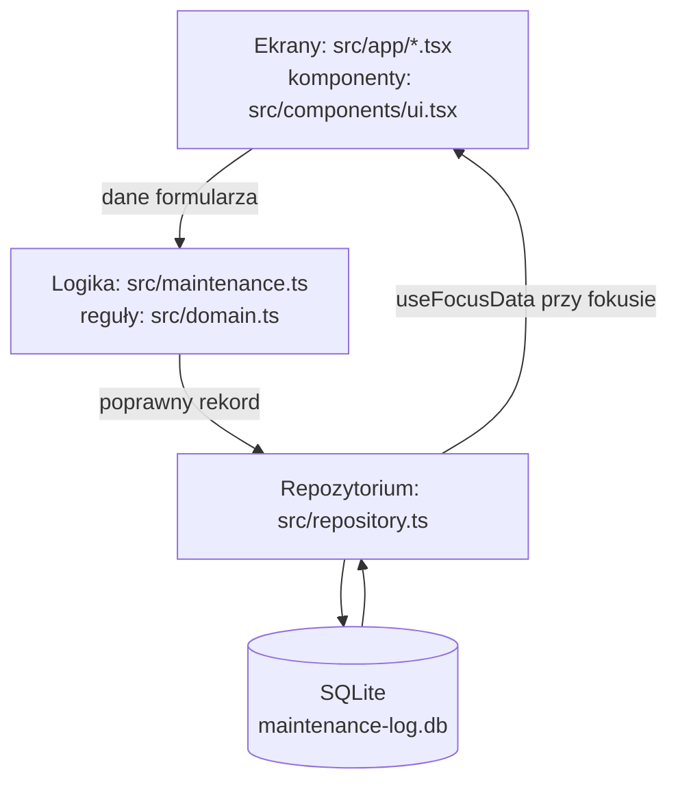
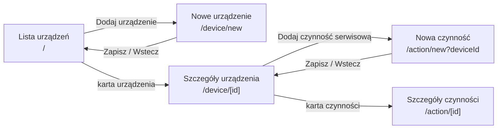
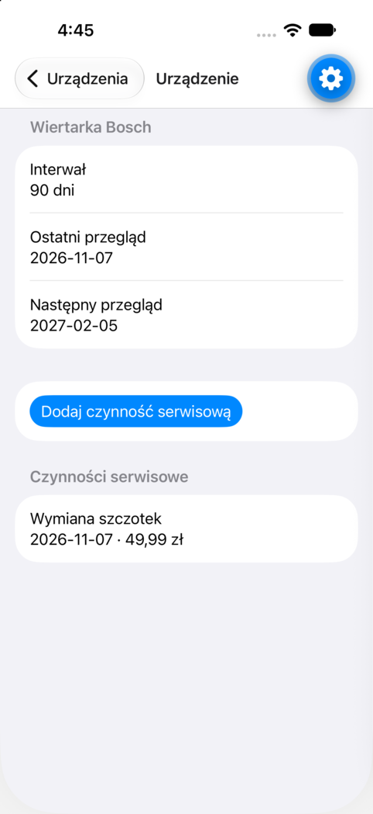
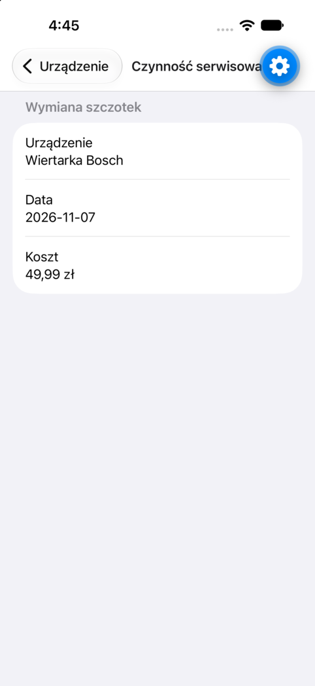
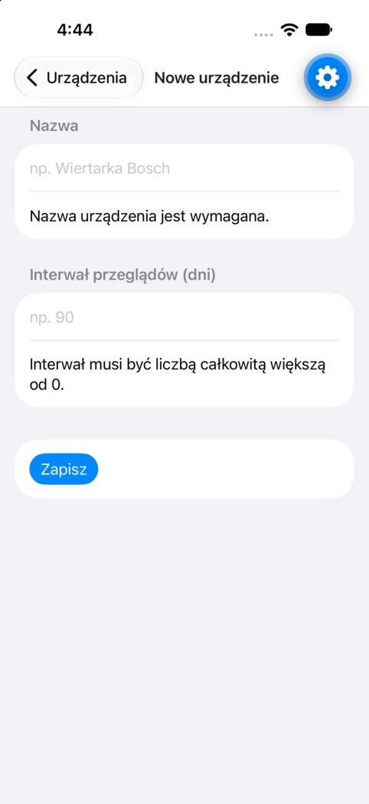

# Sprawozdanie — Laboratorium 2

**Przedmiot:** Budowa aplikacji mobilnych z użyciem technologii frontendowych  
**Student / identyfikator:** Artur Rok, grupa 43_Inf_FD_NW_7  
**Projekt biznesowy:** MOB-050 — MaintenanceLog  
**Framework:** React Native (Expo SDK 57)  
**Data zajęć:** 2026-11-07  
**Repozytorium:** https://github.com/rokartur/supreme-pancake  
**Commit / tag odpowiadający oddaniu:** commit na gałęzi `main` z plikiem `reports/lab-02.md`

> Wypełnione na podstawie własnych działań. Wyniki testów pochodzą z uruchomienia `bun test` oraz z symulatora iPhone 18 Pro (iOS 27) z Expo Go.

## T1. Analiza podejść do tworzenia aplikacji

**Cel:** świadomy wybór podejścia w kontekście wymagań własnego projektu.

| Wymaganie z projektu | Znaczenie dla wyboru technologii | Wniosek |
| -------------------- | -------------------------------- | --------- |
| W1: MOB-050-FR-11 i TECH-04, dane zostają po restarcie, działanie bez sieci | Potrzebna lokalna baza z relacjami. Natywne i wieloplatformowe podejścia mają SQLite na urządzeniu. PWA ma IndexedDB, ale przeglądarka (szczególnie Safari na iOS) może usunąć dane witryny przy braku miejsca lub długim nieużywaniu. | Aplikacja instalowana z lokalnym SQLite (`expo-sqlite`). PWA odpada. |
| W2: TECH-01 i TECH-02, jedna technologia z listy, uruchomienie na Androidzie lub iOS | Wymaganie wyklucza czyste PWA i aplikację tylko webową. Podejście natywne wymagałoby dwóch baz kodu (Kotlin i Swift). | Wieloplatformowe: jeden kod TypeScript dla obu systemów. |
| W3: MOB-050-FR-08, BR-01..BR-04, walidacja i reguły biznesowe testowane automatycznie (TEST-01, TEST-02) | Reguły muszą być w czystym kodzie, który da się testować bez emulatora. W React Native logika to zwykły TypeScript. | `src/domain.ts` bez importów z React Native, testy `bun test` w kilka milisekund. |

**Porównanie podejść i uzasadnienie:**

- **Natywne (Kotlin/Compose, Swift/SwiftUI):** pełny dostęp do API i najlepsza wydajność, ale MaintenanceLog to formularze i listy, bez aparatu ani grafiki. Dwie bazy kodu podwajają pracę jednej osoby w jednym semestrze. Nie pasuje do skali projektu.
- **Hybrydowe WebView (Ionic + Capacitor):** jeden kod HTML/CSS/JS w natywnym kontenerze, SQLite przez wtyczkę. Spełniłoby W1, ale nie W2: Ionic nie jest na liście TECH-01. UI w WebView odbiega też od natywnych kontrolek (przewijanie, klawiatura).
- **Wieloplatformowe (React Native, Flutter, NativeScript):** jeden kod, natywny UI (React Native, NativeScript) albo własny renderer (Flutter), lokalne bazy danych dostępne jako moduły. Spełnia W1, W2 i W3.
- **PWA:** brak instalacji ze sklepu, dane w IndexedDB zależne od polityki przeglądarki. Nie spełnia W2 ani pewnie W1.

**Decyzja z laboratorium 1 pozostaje bez zmian:** React Native z Expo. Uzasadnienie po laboratorium 2: `expo-sqlite` jest w Expo SDK 57 i działa w Expo Go, więc trwały zapis nie wymagał development builda; Expo Router dał nawigację z plików bez ręcznej konfiguracji; logika w TypeScript jest testowana bez urządzenia.

**Wskazane źródła (dokumentacja, artykuły techniczne):**

- Expo, „SQLite (expo-sqlite)”, https://docs.expo.dev/versions/v57.0.0/sdk/sqlite/, dostęp 2026-11-07: API `openDatabaseSync`, `getAllAsync`, `runAsync`, wybór magazynu danych.
- Expo, „Crypto (expo-crypto)”, https://docs.expo.dev/versions/v57.0.0/sdk/crypto/, dostęp 2026-11-07: `randomUUID()` do identyfikatorów.
- Ionic, „Capacitor: cross-platform native runtime”, https://capacitorjs.com/docs, dostęp 2026-11-07: model aplikacji hybrydowej WebView.
- MDN, „Storage quotas and eviction criteria”, https://developer.mozilla.org/en-US/docs/Web/API/Storage_API/Storage_quotas_and_eviction_criteria, dostęp 2026-11-07: kiedy przeglądarka usuwa dane PWA.
- Materiały Moodle „Źródła wiedzy” do tematu 2: definicje czterech podejść i schemat warstw.

## T2. Projekt architektury aplikacji

**Cel:** zaprojektowanie struktury umożliwiającej dalszy rozwój i testowanie.

### T2.1. Diagram architektury

**Diagram / odnośnik:** [`docs/architecture.md`](../docs/architecture.md), sekcja „Diagram warstw i przepływu danych” (Mermaid).

### T2.2. Model danych

| Encja     | Pole | Typ    | Wymagane | Znaczenie |
| --------- | ---- | ------ | -------- | --------- |
| Device | `id` | UUID (TEXT) | Tak | klucz główny |
| Device | `name` | TEXT | Tak | nazwa urządzenia, niepusta (BR-03) |
| Device | `intervalDays` | INTEGER | Tak | interwał przeglądów w dniach, `> 0` (BR-01) |
| ServiceAction | `id` | UUID (TEXT) | Tak | klucz główny |
| ServiceAction | `deviceId` | UUID (TEXT), FK | Tak | urządzenie nadrzędne (`parentId` z karty) |
| ServiceAction | `date` | TEXT `RRRR-MM-DD` | Tak | data czynności, poprawna data kalendarzowa |
| ServiceAction | `description` | TEXT | Tak | opis, niepusty |
| ServiceAction | `costCents` | INTEGER | Tak | koszt w groszach, `>= 0` (BR-01); typ całkowity zamiast `float` |

**Relacja i sposób zapewnienia spójności (np. usuwanie encji nadrzędnej):**

Device (1) → (N) ServiceAction. W `src/repository.ts` tabela `service_actions` ma `deviceId TEXT NOT NULL REFERENCES devices(id) ON DELETE RESTRICT`, a połączenie włącza `PRAGMA foreign_keys = ON` (SQLite domyślnie nie sprawdza kluczy obcych). Skutki:

- czynność z nieistniejącym `deviceId` nie zostanie zapisana (MOB-050-BR-04, pierwsza część);
- usunięcie urządzenia z czynnościami zostanie odrzucone przez bazę (BR-04, druga część). Ekran usuwania powstanie w laboratorium 3 i pokaże komunikat o liczbie powiązanych czynności przed próbą usunięcia.

Ograniczenia `CHECK` (`intervalDays > 0`, `costCents >= 0`, niepuste teksty) dublują walidację z `src/domain.ts`, więc błędne dane nie trafią do bazy także przy błędzie w kodzie UI.

### T2.3. Decyzje projektowe

| Decyzja                | Wybrane rozwiązanie | Alternatywa | Uzasadnienie |
| ---------------------- | ------------------- | ----------- | ------------ |
| Zarządzanie stanem     | `useState` w formularzach + hook `useFocusData` czytający z bazy przy każdym wejściu na ekran | Zustand lub React Query | Źródłem prawdy jest SQLite. Globalny magazyn byłby drugą kopią danych do synchronizacji. Dla jednego użytkownika i kilku ekranów odczyt przy fokusie wystarcza. |
| Przechowywanie danych  | `expo-sqlite` (SQLite) | AsyncStorage (klucz-wartość, JSON) | Relacja 1:N, klucz obcy z `RESTRICT`, `CHECK` i zapytanie `MAX(date)` dla BR-02. W AsyncStorage spójność relacji trzeba by pilnować ręcznie. |
| Nawigacja              | Expo Router, nawigator Stack | React Navigation konfigurowane ręcznie, zakładki | Hierarchia lista → szczegóły → formularz to naturalny stos. Trasy z plików w `src/app/`, typowane parametry. |
| Separacja logiki od UI | `domain.ts` (czyste funkcje), `maintenance.ts` (przypadki użycia), `repository.ts` (SQL) | walidacja i SQL wewnątrz ekranów | Reguły testowane bez emulatora, ekrany nie znają SQL, zamiana magazynu dotyczy tylko `repository.ts`. |

**Plik `docs/architecture.md`:** [docs/architecture.md](../docs/architecture.md)

## T3. Nawigacja i ekrany

**Cel:** przygotowanie struktury interfejsu aplikacji.

**Schemat nawigacji:**

| Ekran     | Plik / komponent | Przejście do / z ekranu | Dowód działania |
| --------- | ---------------- | ----------------------- | --------------- |
| Lista | `src/app/index.tsx` (`DeviceListScreen`) | do: szczegóły urządzenia, formularz urządzenia; ekran startowy |  |
| Szczegóły | `src/app/device/[id].tsx` (`DeviceDetailsScreen`), `src/app/action/[id].tsx` (`ServiceActionDetailsScreen`) | z: lista; do: formularz czynności, szczegóły czynności |   |
| Formularz | `src/app/device/new.tsx`, `src/app/action/new.tsx`; pola `FormField` z `src/components/ui.tsx` (natywny formularz: SwiftUI `Form` na iOS, Jetpack Compose na Androidzie, przez `@expo/ui`) | z: lista lub szczegóły urządzenia; po zapisie `router.back()` |  |

**Dlaczego taki układ nawigacji jest odpowiedni dla użytkownika?**

Opiekun urządzeń myśli o sprzęcie: najpierw wybiera urządzenie, potem patrzy na jego historię i datę następnego przeglądu. Dlatego listą startową są urządzenia z datą następnego przeglądu na karcie, a czynności są dodawane z ekranu konkretnego urządzenia. Dzięki temu `deviceId` przychodzi z nawigacji, a użytkownik nie może utworzyć czynności bez urządzenia (BR-04). Stack daje systemowy gest i przycisk Wstecz, a po zapisie formularz sam się zamyka i wraca do miejsca, z którego go otwarto.

## T4. Operacje Create i Read

**Cel:** implementacja pierwszych operacji CRUD z trwałym przechowywaniem danych.

**Powiązanie z wymaganiami biznesowymi (ID wymagań):** MOB-050-FR-01 (dodawanie i wyświetlanie czynności), FR-02 (tworzenie i przeglądanie urządzeń), FR-03 (przypisanie czynności do urządzenia), FR-04 (lista i szczegóły), FR-08 (walidacja), FR-09 (pusta lista, komunikaty błędów), FR-10 (następny przegląd), FR-11 (trwałość); reguły BR-01, BR-02, BR-03, BR-04.

| Operacja         | Lokalizacja kodu | Reguła walidacji / zachowanie | Wynik |
| ---------------- | ---------------- | ----------------------------- | ----- |
| Create | `src/app/device/new.tsx` → `addDevice` (`src/maintenance.ts`) → `parseDevice` (`src/domain.ts`) → `insertDevice` (`src/repository.ts`); analogicznie `action/new.tsx` → `addServiceAction` → `parseServiceAction` → `insertServiceAction` | nazwa niepusta; interwał liczbą całkowitą `> 0`; data `RRRR-MM-DD` istniejąca w kalendarzu; opis niepusty; koszt `>= 0`, maks. 2 miejsca po przecinku, zapis w groszach | rekord zapisany, powrót do poprzedniego ekranu, błędne pola podświetlone z komunikatem (TC-01, TC-02, TC-06) |
| Read (lista) | `src/app/index.tsx`, `listDevices` w `src/repository.ts` | `LEFT JOIN` z `MAX(date)`, sortowanie po nazwie; na karcie `nextReviewDate` (BR-02); pusty stan z instrukcją | lista z datą następnego przeglądu, pusty stan (TC-01, TC-05) |
| Read (szczegóły) | `src/app/device/[id].tsx` (`getDevice`, `listServiceActions`), `src/app/action/[id].tsx` (`getServiceAction`) | brak rekordu: komunikat „Nie znaleziono”; czynności posortowane od najnowszej | poprawne dane rekordu (TC-03) |

**Wyjaśnij przepływ danych po naciśnięciu „Zapisz”:**

1. `Button` w `src/app/action/new.tsx` wywołuje `save()`. Ekran ustawia `saving = true`, przycisk pokazuje „Zapisywanie...” i jest zablokowany przed drugim tapnięciem.
2. `save()` przekazuje surowe teksty z `useState` do `addServiceAction(deviceId, form)` w `src/maintenance.ts`.
3. `addServiceAction` wywołuje `parseServiceAction` z `src/domain.ts`. Funkcja przycina teksty, sprawdza datę, zamienia `"49,99"` na `4999` groszy i zwraca `{ errors, value }`.
4. Jeżeli są błędy, `addServiceAction` zwraca `{ errors, id: null }` bez dotykania bazy. Ekran zapisuje `errors` w stanie i `FormField` pokazuje komunikat w wierszu pod polem, w tej samej sekcji formularza.
5. Dla poprawnych danych `insertServiceAction` w `src/repository.ts` generuje UUID (`expo-crypto`) i wykonuje `INSERT` przez `db.runAsync`. Klucz obcy odrzuca nieistniejące urządzenie.
6. Po sukcesie ekran wywołuje `router.back()`. Ekran szczegółów urządzenia odzyskuje fokus, `useFocusData` ponownie wywołuje `getDevice` i `listServiceActions`, więc nowa czynność i przeliczona data następnego przeglądu pojawiają się bez ręcznego odświeżania.
7. Wyjątek z bazy (np. pełny dysk, brak urządzenia) trafia do `catch`: `Alert` „Błąd zapisu”, formularz zachowuje wpisane dane.

## T5. Weryfikacja działania i wnioski

Testy manualne na symulatorze iPhone 18 Pro (iOS 27), Expo Go dla SDK 57, 2026-11-07. Testy automatyczne: `bun test src` (10 testów, 0 błędów).

| ID    | Scenariusz                           | Oczekiwany rezultat             | Wynik (PASS/FAIL) | Dowód / uwagi |
| ----- | ------------------------------------ | ------------------------------- | ----------------- | ------------- |
| TC-01 | Dodanie poprawnego rekordu           | Rekord jest zapisany i widoczny | PASS | Urządzenie „Wiertarka Bosch”, 90 dni, widoczne na liście; czynność „Wymiana szczotek”, 2026-11-07, 49,99 zł widoczna w szczegółach urządzenia, następny przegląd 2027-02-05. [lista](assets/lab-02/tc01-list.png), [szczegóły](assets/lab-02/tc01-device-details.png) |
| TC-02 | Próba zapisu pustego wymaganego pola | Zapis zablokowany, komunikat    | PASS | Pusty formularz urządzenia: „Nazwa urządzenia jest wymagana.” i „Interwał musi być liczbą całkowitą większą od 0.”, ekran nie został zamknięty. [zrzut](assets/lab-02/tc02-validation.png) |
| TC-03 | Otwarcie szczegółów rekordu          | Poprawne dane rekordu           | PASS | Szczegóły czynności: opis, urządzenie, data, koszt zgodne z wpisanymi. [zrzut](assets/lab-02/tc03-action-details.png) |
| TC-04 | Ponowne uruchomienie aplikacji       | Rekord pozostaje dostępny       | PASS | `xcrun simctl terminate` Expo Go, ponowne otwarcie projektu: urządzenie i data następnego przeglądu nadal widoczne. [zrzut](assets/lab-02/tc04-after-restart.png) |
| TC-05 | Brak rekordów                        | Czytelny stan pustej listy      | PASS | „Brak urządzeń. Dodaj pierwsze urządzenie, aby planować przeglądy.” [zrzut](assets/lab-02/tc05-empty-list.png) |
| TC-06 | Koszt ujemny (BR-01, kryterium akceptacji 2) | Zapis zablokowany, przyczyna widoczna | PASS | Koszt `-5`: „Koszt musi być liczbą większą lub równą 0, maks. 2 miejsca po przecinku.” [zrzut](assets/lab-02/tc06-cost-rule.png) |

**Najważniejszy napotkany problem i sposób rozwiązania:**

Przechowywanie kwot i dat. Karta wymaga wartości dziesiętnych zamiast binarnego `float`, a SQLite nie ma typu `DECIMAL`. Koszt jest więc zapisywany jako liczba całkowita groszy (`costCents`), a `parseCostCents` dzieli tekst na część całkowitą i ułamkową zamiast mnożyć `float` przez 100 (`0.29 * 100` daje `28.999999999999996`). Podobnie z datami: `new Date("2026-11-07")` jest interpretowane jako północ UTC, a w polskiej strefie czasowej mogłoby pokazać inny dzień. Daty są zapisywane jako tekst `RRRR-MM-DD`, a `nextReviewDate` dodaje dni w UTC, co pokrywają testy przejścia przez koniec miesiąca i roku.

Drugi problem był techniczny: TypeScript 6 domyślnie nie ładuje typów z `@types/*`, więc import `bun:test` nie miał typów. Rozwiązanie: dyrektywa `/// <reference types="bun" />` tylko w pliku testu, żeby typy Buna nie trafiały do kodu aplikacji. ESLint 10 nie działał z `eslint-plugin-react` z `eslint-config-expo`, więc projekt używa ESLint 9.

**Co wymaga dalszej pracy przed laboratorium 3?**

- edycja i usuwanie czynności z potwierdzeniem (FR-01, FR-09) oraz edycja urządzenia (FR-02);
- blokada usunięcia urządzenia z czynnościami z czytelnym komunikatem w UI (BR-04);
- wyszukiwanie, filtr po urządzeniu i sortowanie z kierunkiem (FR-05..FR-07);
- wybór daty przez systemowy selektor zamiast pola tekstowego;
- komunikat sukcesu po zapisie (UX-03), teraz informacją jest tylko powrót do listy.

**Wnioski (3–6 zdań, odnoszące się do własnej implementacji):**

Oddzielenie `domain.ts` od ekranów pozwoliło przetestować reguły BR-01..BR-03 i obliczenie następnego przeglądu w 5 ms, bez symulatora. Trwałość zapewnia SQLite, a reguły spójności są zapisane dwa razy: w walidacji z komunikatami dla użytkownika i w ograniczeniach bazy, które chronią dane przy błędzie w kodzie. Odczyt danych przy każdym fokusie ekranu okazał się prostszy niż globalny magazyn stanu i sam rozwiązuje odświeżanie listy po zapisie. Najwięcej uwagi wymagały typy danych (grosze, daty bez strefy czasowej), bo błąd w tych miejscach nie byłby widoczny przy pierwszym teście, a dopiero przy konkretnych kwotach lub datach.

## Materiały dowodowe i historia pracy

- Issue(s): brak (do założenia przed laboratorium 3, GIT-05)
- Pull Request(s): brak (zmiany na `main`; gałęzie i PR od laboratorium 3, GIT-03, GIT-04)
- Commity związane z laboratorium: commit z niniejszym sprawozdaniem na `main` (https://github.com/rokartur/supreme-pancake/commits/main)
- Diagramy: [`docs/architecture.md`](../docs/architecture.md) (Mermaid: warstwy, ERD), schemat nawigacji w sekcji T3
- Zrzuty ekranu: `reports/assets/lab-02/`
- Instrukcja uruchomienia: [README.md](../README.md)

## Użycie narzędzi AI (jeżeli dotyczy)

**Narzędzie i zakres wsparcia:** Claude Code (Anthropic): propozycja struktury warstw, kod ekranów i repozytorium SQLite, testy reguł, szkic dokumentacji i sprawozdania.  
**Jak zweryfikowano wynik:** dokumentacja Expo SDK 57 (`expo-sqlite`, `expo-crypto`), `bunx tsc --noEmit`, `bunx expo lint`, `bun test src` (10/10), testy manualne TC-01..TC-06 na symulatorze ze zrzutami ekranu; testy sprawdzone celowym wprowadzeniem błędu w `nextReviewDate` i `parseDevice` (2 testy nie przeszły).  
**Elementy wykonane samodzielnie:** wybór frameworka i karty MOB-050, decyzje o przechowywaniu kwot w groszach i blokadzie usuwania urządzenia, przegląd i zrozumienie całego kodu przed oddaniem.

**Warunki formalne:** sprawozdanie w Markdown, czytelne odnośniki do działającego kodu i diagramów, zrzuty ekranu renderujące się w repozytorium, identyfikacja autora i projektu.
